<p align="center">
  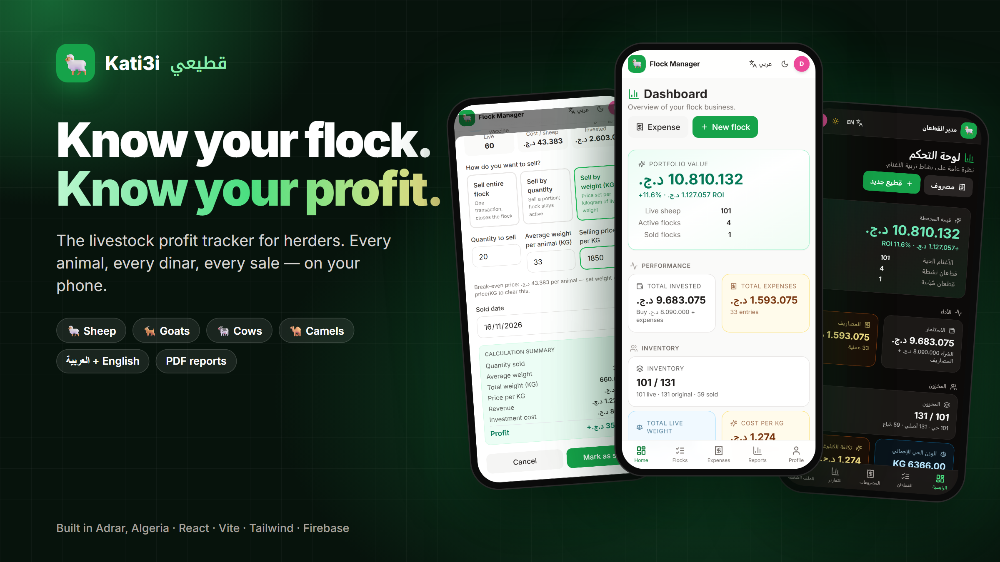
</p>

<h1 align="center">Kati3i · قطيعي</h1>

<p align="center">
  <b>The livestock profit tracker for herders.</b><br>
  Every animal, every dinar, every sale — on your phone, in Arabic or English.
</p>

<p align="center">
  
  
  
  
  
</p>

---

**Kati3i** (قطيعي, "my flock") answers the one question every herder asks and
almost nobody can answer exactly: **"What did this animal really cost me, and
what must I sell it for?"**

You buy a flock, you feed it for months, you pay for water, medicine, transport
and a shepherd, you lose an animal or two — and on market day you sell from
memory. Kati3i replaces the memory and the notebook. Record things as they
happen, and the app keeps the true cost per animal, the break-even price, the
cost per kilo and the profit on every sale up to date for you.

Inside the app it is called **Flock Manager**.

## Watch it work

<p align="center">
  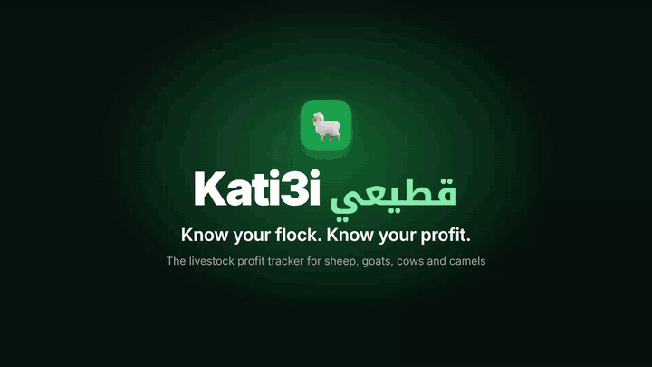
</p>

<p align="center"><a href="docs/promo.mp4">▶ Download the full-quality video (MP4, 1080p)</a></p>

## What it does for you

| | |
|---|---|
| 📊 **One-screen dashboard** | Portfolio value, total invested, total expenses, live head count, total live weight, revenue and realized profit across all your flocks. |
| 🐑 🐐 🐄 🐪 **Any livestock** | Sheep, goats, cows and camels. Add a flock with the head count and price per animal — the total is calculated for you. |
| 🧾 **Every expense, categorised** | Food, water, medicine, transport, workers and more. Search, filter by flock or type, sort by date or amount. |
| 💀 **Deaths handled properly** | Register a loss and the live count drops and the cost per surviving animal is recalculated automatically. |
| ⚖️ **Weight tracking** | Log the average weight over time. The app works out total live weight and **cost per kilo**. |
| 🎯 **Break-even price** | For every flock: the minimum price per animal that recovers what you spent. Sell above it and you are in profit. |
| 💰 **Three ways to sell** | The entire flock, a few head, or **by live weight (price per KG)**. A live preview shows revenue, cost and profit *before* you confirm. |
| 📜 **Sales history** | Every sale is stored with the cost per animal frozen at that moment, so old sales never change when you add new expenses. |
| 📈 **Reports** | Expense breakdown by category, top expenses, and filters by livestock type or single flock. |
| 📄 **PDF flock report** | One tap produces a clean report for any flock — ready to share with a partner or a buyer. |
| 🌍 **Arabic and English** | Full right-to-left Arabic interface, switchable in one tap from any screen. |
| 🌙 **Light and dark themes** | Comfortable in the midday sun and at night. |
| 💱 **Your currency** | DZD by default, with USD, EUR, MAD, EGP and SAR available. |
| 📱 **Made for the phone** | Mobile-first layout that can be added to the home screen and opens like an app. Works on a laptop too. |
| ☁️ **Synced and private** | Sign in on any device and your data is there. Each account can only ever read its own data. |
| 🗄️ **Archive** | Finished flocks move to the archive, out of your totals but never lost. |

## Screenshots

<table>
  <tr>
    <td align="center">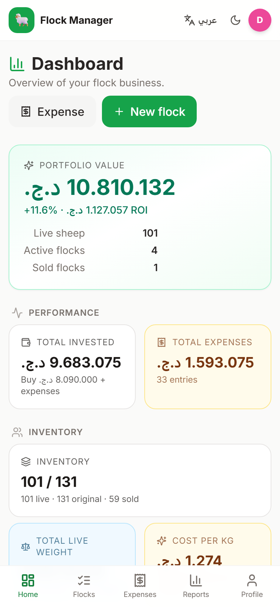<br><sub><b>Dashboard</b><br>The whole business at a glance</sub></td>
    <td align="center">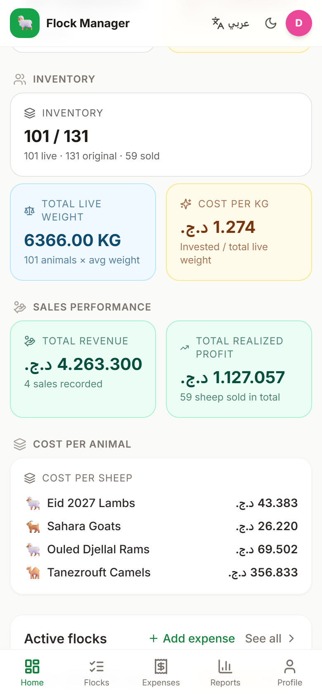<br><sub><b>Inventory &amp; sales</b><br>Live weight, cost per KG, realized profit</sub></td>
    <td align="center">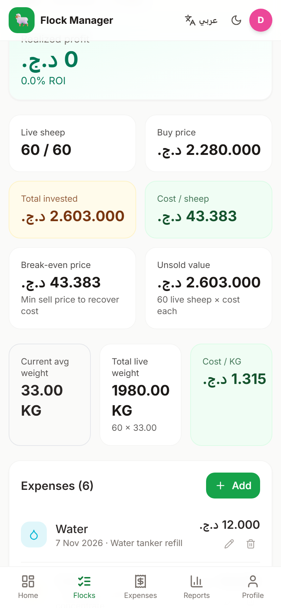<br><sub><b>Flock detail</b><br>Cost per animal and break-even price</sub></td>
  </tr>
  <tr>
    <td align="center">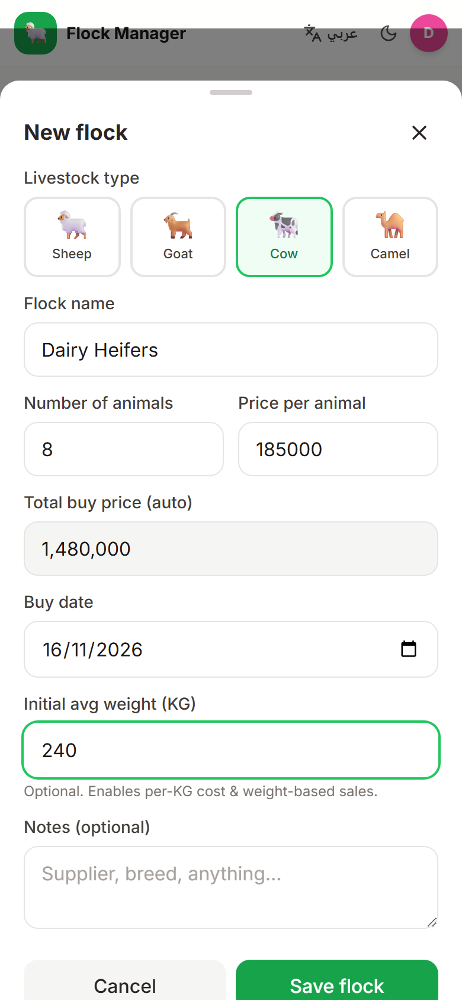<br><sub><b>New flock</b><br>Sheep, goats, cows or camels</sub></td>
    <td align="center">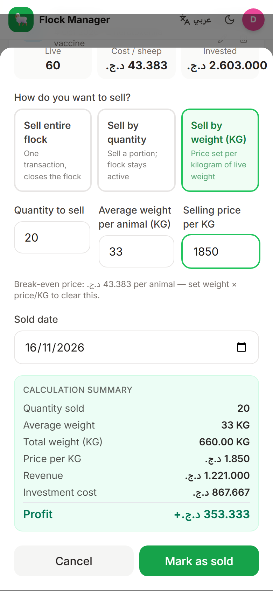<br><sub><b>Sell by weight</b><br>See the profit before you confirm</sub></td>
    <td align="center">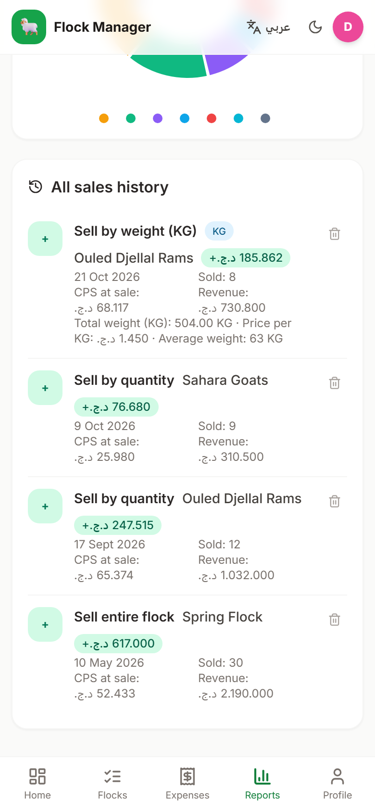<br><sub><b>Sales history</b><br>Profit recorded on every sale</sub></td>
  </tr>
  <tr>
    <td align="center">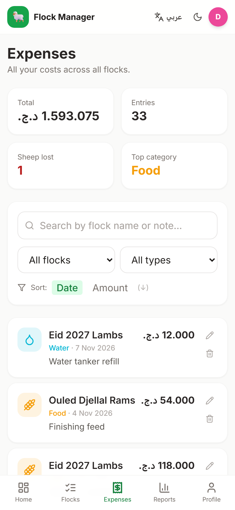<br><sub><b>Expenses</b><br>Search, filter and sort every cost</sub></td>
    <td align="center">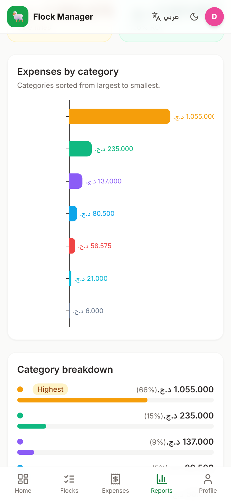<br><sub><b>Reports</b><br>Where the money goes</sub></td>
    <td align="center">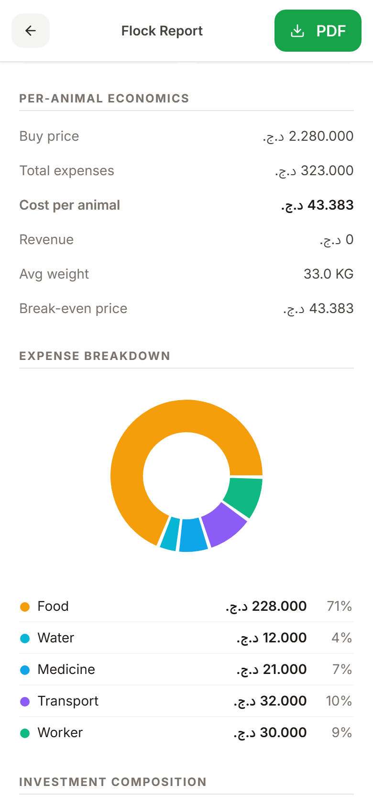<br><sub><b>PDF report</b><br>One tap to download</sub></td>
  </tr>
  <tr>
    <td align="center">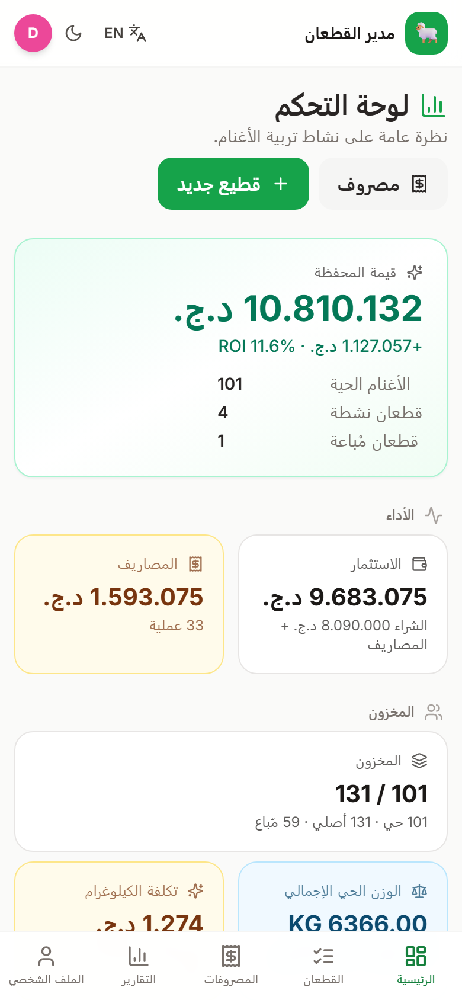<br><sub><b>العربية</b><br>Full right-to-left interface</sub></td>
    <td align="center">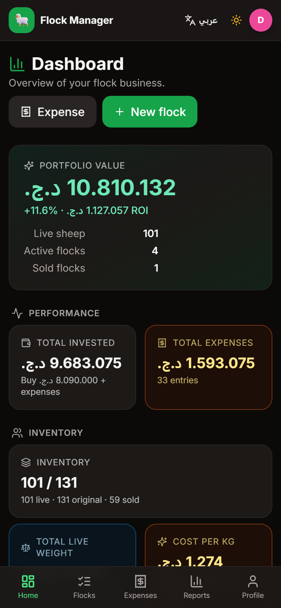<br><sub><b>Dark theme</b><br>Easy on the eyes at night</sub></td>
    <td align="center">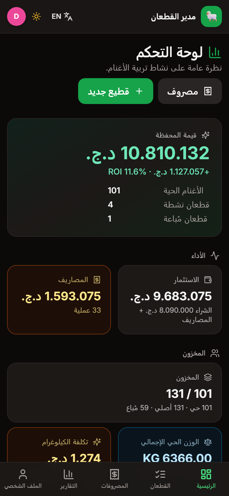<br><sub><b>Arabic + dark</b><br>Both together</sub></td>
  </tr>
</table>

<sub>All screenshots and the video use the built-in demo data. No real herd, buyer or price list appears anywhere in this repository.</sub>

## Try it in 30 seconds — no account, no Firebase

The repository ships with a **demo mode** that runs the full app on realistic
sample data, entirely in your browser.

```bash
git clone https://github.com/TOUMO45/Kati3i.git
cd Kati3i
npm install
npm run demo
```

Open <http://localhost:5180>. You are signed in as a sample herder with five
flocks, a season of expenses, weight records and sales. Add, edit, sell and
delete freely — nothing is saved, and a refresh resets everything.

## Run it for real

Kati3i stores your data in your own Firebase project (the free tier is enough
for a family business).

**1. Create the Firebase project**

1. Go to <https://console.firebase.google.com> and create a project.
2. Add a **Web app** (`</>`) and copy its config values.
3. **Build → Authentication → Sign-in method** → enable **Email/Password**.
4. **Build → Firestore Database → Create database** (production mode).
5. **Build → Storage → Get started** (used for profile photos).

**2. Configure the app**

```bash
cp .env.example .env
```

Fill `.env` with the values from step 1:

```
VITE_FIREBASE_API_KEY=...
VITE_FIREBASE_AUTH_DOMAIN=your-project.firebaseapp.com
VITE_FIREBASE_PROJECT_ID=your-project-id
VITE_FIREBASE_STORAGE_BUCKET=your-project.appspot.com
VITE_FIREBASE_MESSAGING_SENDER_ID=...
VITE_FIREBASE_APP_ID=...
VITE_DEFAULT_CURRENCY=DZD
```

**3. Deploy the security rules** (so each user can only see their own data)

```bash
npm i -g firebase-tools
firebase login
cp .firebaserc.example .firebaserc   # then put your project id in it
firebase deploy --only firestore:rules,storage
```

**4. Start**

```bash
npm run dev
```

Open <http://localhost:5173>, create an account and add your first flock.

## Put it online

The repo is ready for **Netlify** (`netlify.toml` is included):

1. Push your copy to GitHub.
2. In Netlify: **Add new site → Import an existing project** and pick the repo.
3. Under **Site settings → Environment variables**, add every `VITE_*` value from your `.env`.
4. Deploy. Open the link on your phone and choose **Add to Home Screen**.

Any static host works: `npm run build` produces a plain `dist/` folder.

## How the numbers are calculated

The maths lives in one small, dependency-free file,
[`src/utils/calculations.js`](src/utils/calculations.js).

| Number | Formula |
|---|---|
| **Total invested** | purchase price + every expense on the flock |
| **Cost per animal** | total invested ÷ (animals bought − animals lost) |
| **Break-even price** | equal to the cost per animal — sell above it to profit |
| **Live animals** | animals bought − animals lost − animals sold |
| **Total live weight** | latest average weight × live animals |
| **Cost per KG** | total invested ÷ total live weight |
| **Profit on a sale** | sale revenue − (cost per animal at that moment × animals sold) |
| **Flock profit** | the sum of the profit of its sales — unsold animals are carried at cost, so they count as neither profit nor loss |
| **ROI** | profit ÷ total invested |
| **Portfolio value** | total invested + profit, i.e. money received from sales + money still tied up in unsold animals |

The sale that closes a flock carries whatever cost earlier sales have not yet
recovered, so a finished flock's profit always equals **everything it sold for −
everything it cost**.

Selling animals does **not** change the cost per animal — only new expenses,
deaths or an edited purchase do. That matches how a herder actually reasons
about what each head has cost.

## Privacy and security

- **Your data is yours.** Everything is stored under `users/{your-id}/…` and the
  included [`firestore.rules`](firestore.rules) and [`storage.rules`](storage.rules)
  reject any request that is not from the signed-in owner.
- **No secrets in this repository.** Firebase settings are read from a local
  `.env` file that is git-ignored; only `.env.example` with placeholders is committed.
- **No tracking, no ads, no third-party analytics.**

## Project structure

```
Kati3i/
├── docs/                    # banner, screenshots and promo video
├── public/                  # icons + web app manifest
├── src/
│   ├── pages/               # Dashboard, Flocks, FlockDetail, FlockReport,
│   │                        # Expenses, Reports, Profile, Login
│   ├── components/          # layout, modals (flock, expense, weight, sell), histories
│   ├── context/             # auth, locale (EN/AR + RTL), theme
│   ├── hooks/useFirestore.js   # every Firestore read/write in one place
│   ├── demo/                # in-memory data + auth used by `npm run demo`
│   ├── i18n/translations.js # all English and Arabic strings
│   ├── utils/               # calculations, formatting, livestock types
│   └── lib/firebase.js      # Firebase init + friendly config check
├── firestore.rules          # per-user data isolation
├── storage.rules            # per-user file isolation
├── netlify.toml             # build + SPA redirects
└── .env.example             # the settings you need to provide
```

| Command | What it does |
|---|---|
| `npm run demo` | Full app on sample data, no Firebase (port 5180) |
| `npm run dev` | Development server against your Firebase project (port 5173) |
| `npm run build` | Production build into `dist/` |
| `npm run build:demo` | Static build of the demo into `dist-demo/` |

## Built with

React 18 · Vite 5 · Tailwind CSS · Firebase (Auth, Firestore, Storage) ·
Recharts · jsPDF + html2canvas · lucide-react · date-fns

---

<p align="center">
  <b>Welcome to 2027 — with easy work.</b><br>
  From Adrar, Algeria 🇩🇿
</p>
